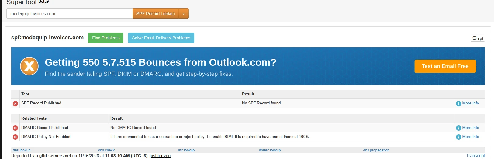
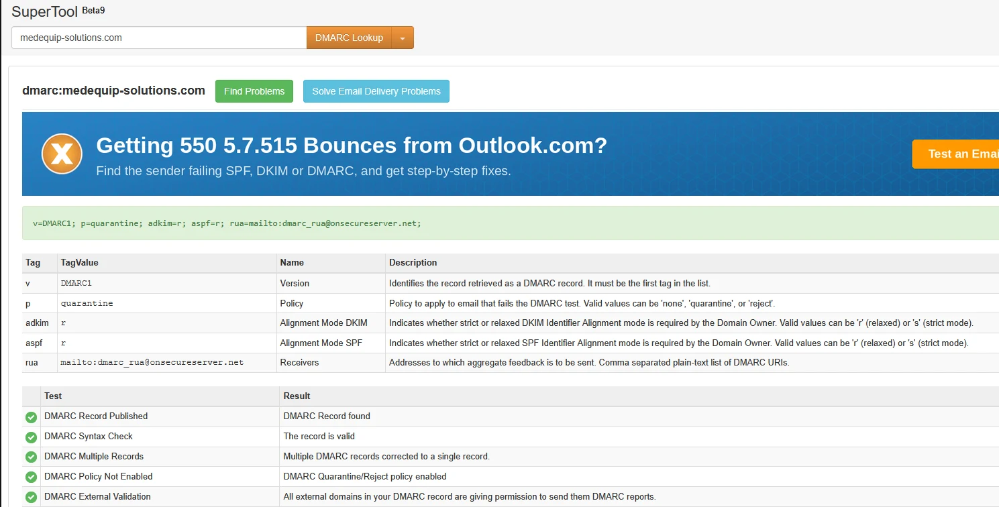
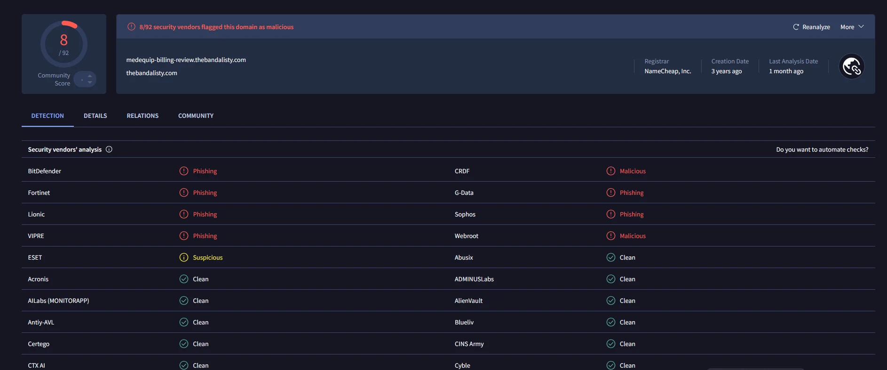
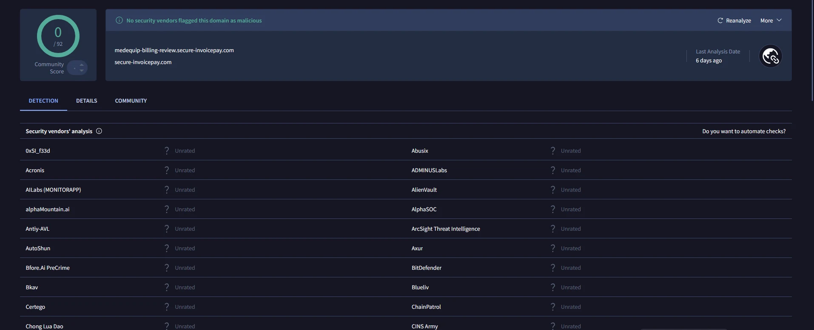
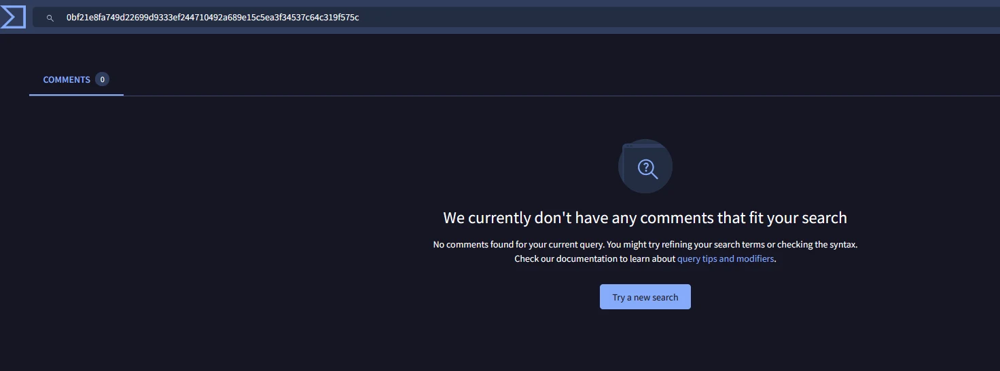

# Strengthening Cyber Resilience through Phishing Email Investigation and Response in Healthcare

**MediSure Health Network | Tier 1 SOC case study | Simulated vendor-invoice phishing**

The training email posed as a medical supplies vendor and demanded **USD 18,740 within 24 hours**, threatening to suspend deliveries if Accounts Payable failed to pay invoice **MSH-2024-0912**. The investigation examined the original email, validated the sender domains, compared the payment links, and identified the evidence needed to confirm impact.

| Case detail | Finding |
| --- | --- |
| Verdict | **Simulated vendor-invoice phishing** |
| Intended recipient | MediSure Accounts Payable |
| Receipt recorded in sample | 9 September 2024, 07:14:52 UTC |
| External lookups | 16 November 2026, using MXToolbox and VirusTotal |
| Impact | Final mailbox disposition, recipient activity, payment, and data exposure remain unverified |
| Response status | Proposed actions for a live incident |

The scenario illustrates the risk of fraudulent payments and disruption to critical healthcare supplies. If a similar message led to credential compromise in a live environment, the SOC would also assess whether the affected account could access patient portals, electronic health records, or other sensitive systems.

**Triage summary.** Classify the message as simulated vendor-invoice phishing. Failed email authentication, mismatched payment destinations and an HTML attachment presented as a PDF support that verdict. Delivery and user impact remain unverified. For a live case, prioritise the mail trace and confirm payment status with Accounts Payable.

[Read the analyst handoff](#7-report-and-hand-off) · [View the lookup screenshots](#investigation-screenshots)

## Investigation walkthrough

### 1. Review the original email

Open a working copy of the training `.eml` in **Notepad** to inspect the raw headers and message body as text. Preserve the original file and leave the links and attachment unopened. Record the subject, visible sender, return path, reply address, recipient, timestamp, and Message-ID.

| Header or feature | Evidence |
| --- | --- |
| Visible From | MedEquip Solutions Billing at `medequip-solutions[.]com` |
| Return-Path | Envelope sender at `medequip-invoices[.]com` |
| Reply-To | Gmail address |
| Received | One recorded hop from `mail.medequip-invoices[.]com` (`192.168.0.50`) to the simulated MediSure mail server |
| Message-ID | `<20240909071450.4471.acctrecovery@medequip-invoices.com>` |
| Social engineering | Urgent overdue invoice, 24-hour deadline, and threat to suspend supply deliveries |

The differences between the visible sender, envelope sender, and reply destination justified a closer look. Public IP reputation was outside the scope for `192.168.0.50` because it is a private address.

### 2. Validate email authentication and current DNS

Read `Authentication-Results` in the original email. The sample reported **SPF fail** for the envelope sender, **DKIM none** for an unsigned message, and **DMARC fail**, with `action=quarantine` recorded in the header.

Use the [MXToolbox SuperTool](https://mxtoolbox.com/SuperTool.aspx) lookup box for the following checks.

| Lookup input | Result on 16 November 2026 |
| --- | --- |
| `spf:medequip-invoices.com` | No SPF record found for the envelope sender domain. [Screenshot](evidence/mxtoolbox-spf.webp) |
| `dmarc:medequip-solutions.com` | MXToolbox reported a valid DMARC record with `p=quarantine`, `adkim=r`, and `aspf=r`. Both alignment settings were relaxed. [Screenshot](evidence/mxtoolbox-dmarc.webp) |

The DNS results describe the records observed in November 2026. The authentication results describe what the September 2024 training header reported. The header provides no final quarantine or delivery event.

### 3. Inspect the links and attachment

In the raw email, compare the URL in the `text/plain` part with the `href` behind **Review & Pay Invoice** in the `text/html` part. When reading quoted-printable text, join lines where a trailing `=` marks a soft line break and read `=3D` as `=`. Record the destinations in defanged form.

Use [VirusTotal Search](https://www.virustotal.com/gui/home/search) to look up **existing hostname reports**. Enter each hostname in the search box and keep the payment links unopened.

| Where it appeared | Defanged hostname | VirusTotal result on 16 November 2026 |
| --- | --- | --- |
| HTML payment button | `medequip-billing-review.thebandalisty[.]com` | **8/92** vendors flagged the host. Six labelled it phishing and two labelled it malicious. [Screenshot](evidence/virustotal-html-payment-host.webp) |
| Plain-text payment link | `medequip-billing-review.secure-invoicepay[.]com` | **0/92** vendors flagged the host. The report displayed multiple unrated vendors. Its safety remains unverified. [Screenshot](evidence/virustotal-plaintext-payment-host.webp) |
| Hidden tracking image | `thebandalisty[.]com` | Found in the HTML source at `/o/MSH20240912.gif`. Image retrieval remains unverified. |

The message offered a PDF, while the MIME attachment was named `Invoice_MSH-2024-0912.html` and declared as `text/html`. In Notepad, locate the part marked `Content-Disposition: attachment`. Static decoding of that part yielded an HTML file with a script tag containing only a training placeholder comment.

Search the decoded attachment's **SHA-256** in VirusTotal using the fingerprint below. The lookup displayed zero matching comments and yielded no file detection result. [Screenshot](evidence/virustotal-attachment-hash.webp)

```text
0bf21e8fa749d22699d9333ef244710492a689e15c5ea3f34537c64c319f575c
```

### 4. Trace potential impact

Use the Message-ID and receipt time to correlate records across the systems available to the analyst. This exercise used the original `.eml` and point-in-time lookup screenshots. The file records receipt by the simulated mail server, with no downstream telemetry available to verify the following outcomes.

| Question | Evidence to request in a live incident |
| --- | --- |
| Which mailboxes received the email, and was it quarantined or removed? | Mail gateway trace, quarantine history, and mailbox remediation records |
| Did a person follow a payment link? | URL protection, proxy, or secure web gateway logs. Check the requested path, timestamp, and user context to distinguish a payment-link request from image retrieval or automated scanning. |
| Was the attachment opened or did it lead to execution? | Endpoint telemetry showing file activity, browser or process events, and associated network connections |
| Were credentials, payment, or patient data affected? | Identity and application audit logs for the relevant accounts, Accounts Payable records, and privacy team review if evidence suggests possible exposure |

### 5. Respond to verified findings

1. Ask Accounts Payable to hold the payment and verify the invoice using the vendor contact already on file.
2. Preserve the original message and relevant logs in the case record. Search for the Message-ID, invoice reference, hostnames, and attachment hash to identify related messages.
3. Quarantine confirmed copies and apply narrowly scoped mail or web controls where the evidence supports them.
4. If credential submission or account compromise is suspected, escalate for credential reset, session revocation, and sign-in review. If endpoint telemetry suggests execution, escalate for endpoint containment under the incident response procedure.
5. Record who took each action, when it happened, which records support it, and what remains open. If evidence indicates possible exposure of electronic protected health information, involve the privacy team to assess the incident and any reporting obligations. See [HHS Security Incident Procedures](https://www.hhs.gov/hipaa/for-professionals/faq/what-does-the-security-rule-require-a-covered-entity-to-do-to-comply/index.html).

### 6. Monitor for recurrence

Use mail gateway searches or alerts for the payment hosts, attachment hash, invoice reference, and repeat vendor impersonation attempts. Review matches for legitimate supplier traffic before broadening a rule. Record repeat reports, confirmed matches, false positives, and any follow-up actions.

**Staff awareness exercise.** An invoice says medical supplies will stop tomorrow unless you pay through a link. The expected response is to pause the payment, report the message through the organisation's phishing-reporting channel, and verify the invoice using the approved vendor record.

### 7. Report and hand off

> **Analyst handoff.** Classify invoice MSH-2024-0912 as simulated vendor-invoice phishing. The sample reports failed email authentication, uses different payment hosts in the plain-text and HTML bodies, and presents an HTML attachment as a PDF. VirusTotal reported eight vendor detections for the HTML payment-button host. Final delivery, user interaction, financial loss, and data exposure remain unverified. In a live case, prioritise the mail trace and confirm payment status with Accounts Payable.

## Investigation screenshots

Captured on 16 November 2026. Expand a screenshot to review the lookup and its result.

<details>
<summary>MXToolbox SPF lookup</summary>



</details>

<details>
<summary>MXToolbox DMARC lookup</summary>



</details>

<details>
<summary>VirusTotal HTML payment host report</summary>



</details>

<details>
<summary>VirusTotal plain-text payment host report</summary>



</details>

<details>
<summary>VirusTotal attachment hash search</summary>



</details>

## MITRE ATT&CK mapping

| Technique | Evidence |
| --- | --- |
| [T1566.002 — Spearphishing Link](https://attack.mitre.org/techniques/T1566/002/) | The message directed a specific Accounts Payable team to payment pages through a targeted invoice lure. The mapping describes the technique illustrated by the simulation. |

## References

- [RFC 8601 — Authentication-Results header](https://www.rfc-editor.org/info/rfc8601/)
- [RFC 9989 — DMARC](https://www.rfc-editor.org/info/rfc9989/)
- [MXToolbox SuperTool](https://mxtoolbox.com/SuperTool.aspx)
- [VirusTotal Search](https://www.virustotal.com/gui/home/search)
